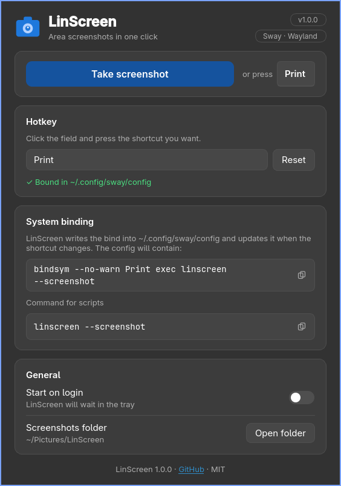
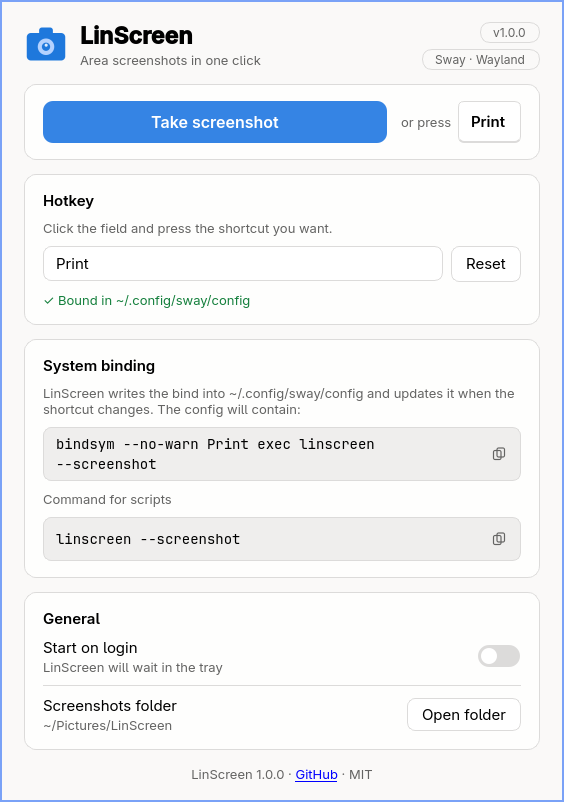

<div align="center">


# LinScreen

**One-click area screenshots for Linux, on Wayland and X11.**

LinScreen sits in the tray, starts on a hotkey and picks the best capture tool for your
desktop. Each shot goes to the clipboard and is saved as a file. On Hyprland, Sway, i3 and Niri
it also writes the hotkey into your compositor config for you.

[](https://github.com/FPP-Labs/linscreen/actions/workflows/ci.yml)
[](https://github.com/FPP-Labs/linscreen/releases/latest)


</div>

---

## Features

- **Works across desktops.** Hyprland (including Omarchy), Sway, i3, Niri, KDE Plasma, GNOME and X11. LinScreen finds a capture backend that works and falls back automatically.
- **Clipboard and file.** Every shot is copied to the clipboard (`wl-copy` on Wayland) and saved to `~/Pictures/LinScreen/`.
- **Hotkeys without editing configs.** Choose a shortcut in the settings window and LinScreen writes the bind into your compositor config, reloads it, and finds it again after a reinstall.
- **Quiet tray app.** Running `linscreen` again opens the settings of the running instance, and `linscreen --screenshot` takes a shot.
- **Modern, adaptive UI.** The settings window follows your system's light or dark palette and reflows when the window is narrow.

## Screenshots

| Dark theme | Light theme |
|:---:|:---:|
|  |  |

---

## Installation

### Arch Linux: prebuilt package

Download `linscreen-1.0.0-1-any.pkg.tar.zst` from [Releases](https://github.com/FPP-Labs/linscreen/releases) and install it:

```bash
sudo pacman -U linscreen-1.0.0-1-any.pkg.tar.zst
```

Then install the capture tools for your desktop (see [Dependencies](#dependencies)). For Hyprland, Sway and Niri:

```bash
sudo pacman -S --needed grim slurp wl-clipboard
```

> An AUR package is planned.

### Arch Linux: build from source

```bash
git clone https://github.com/FPP-Labs/linscreen.git
cd linscreen
makepkg -si
```

The package installs `/usr/bin/linscreen`, a desktop entry, the icon and the license.
After changing the sources, rebuild with `makepkg -sif`. Without `-f`, makepkg reuses the old build.

### Debian / Ubuntu

Download `linscreen_1.0.0-1_all.deb` from [Releases](https://github.com/FPP-Labs/linscreen/releases):

```bash
sudo apt install ./linscreen_1.0.0-1_all.deb
```

`apt` pulls in Python and PyQt6 and, by default, the recommended `grim`, `slurp`, `wl-clipboard` and `xdg-desktop-portal`. Requires Debian 12+ or Ubuntu 24.04+ (`python3-pyqt6` is not packaged in Ubuntu 22.04). Tested on Debian 12 and Ubuntu 24.04.

### Fedora

Download `linscreen-1.0.0-1.noarch.rpm` from [Releases](https://github.com/FPP-Labs/linscreen/releases):

```bash
sudo dnf install ./linscreen-1.0.0-1.noarch.rpm
```

Weak dependencies (`grim`, `slurp`, `wl-clipboard`, `xdg-desktop-portal`) are installed by default. Tested on Fedora 41.

### Other distributions

LinScreen is a single Python script. Install Python 3.10+ and PyQt6 from your distribution, plus the capture tools for your desktop, then:

```bash
install -Dm755 linscreen.py ~/.local/bin/linscreen
linscreen
```

You can also run `python linscreen.py` straight from the repository. Shots are then saved to `./screenshots/`.

---

## Quick start

1. Start **LinScreen** from the application menu or with `linscreen`. An icon appears in the tray.
2. Open the settings from the tray icon and choose a hotkey. On Hyprland, Sway, i3 and Niri the bind is written for you. On KDE and GNOME, add it in the system settings (see below).
3. Press the hotkey and select an area. The shot is in your clipboard and in `~/Pictures/LinScreen/`.

### Hotkeys

On Wayland an application cannot grab global keys itself, because the compositor owns them. When your compositor is configured through a text file, **LinScreen writes the bind into it**:

| Compositor | File managed by LinScreen |
|---|---|
| **Hyprland** (Omarchy, Lua) | `~/.config/hypr/bindings.lua` |
| **Hyprland** | `~/.config/hypr/bindings.conf` or `~/.config/hypr/hyprland.conf` |
| **Sway** / **i3** | `~/.config/sway/config` / `~/.config/i3/config` |
| **Niri** | the `binds` section of `~/.config/niri/config.kdl` |

How it behaves:

- **Changing the shortcut** in the settings adds or updates the bind and reloads the compositor. Hyprland, Sway and i3 reload through their own commands; Niri picks up the file change by itself.
- **Marked block.** LinScreen keeps its lines between `LinScreen: begin` and `LinScreen: end`. A `linscreen --screenshot` bind you wrote by hand is found and taken over.
- **Survives reinstalls.** The shortcut is read back from the compositor config, so it is still there after a reinstall or after LinScreen's own settings are deleted.
- **Nothing happens without you.** If no bind exists yet, the window offers a **"Write to config"** button. LinScreen never edits the file on its own.
- **Safety:**
  - A dated backup `<file>.bak-linscreen-YYYYMMDD` is made before the first edit of the day.
  - Symlinked configs (dotfiles) are edited in place, and file permissions are kept.
  - If a block's markers are broken, LinScreen refuses to touch the file.
  - On Hyprland the key is `unbind`-ed first, and the edit is rolled back if the reload reports a new config error.
  - On Niri, a key that is already taken is reported instead of being overwritten.
  - Single keys without modifiers are limited to Print, F1–F24 and media keys, so a stray letter never becomes a global hotkey.
- **Sway and i3 configs must already exist.** LinScreen does not create one, so it never replaces your distribution's default.

On other desktops, bind the command yourself:

| Desktop | Where |
|---|---|
| **KDE Plasma** | System Settings → Shortcuts → Add New → Command `linscreen --screenshot` |
| **GNOME** | Settings → Keyboard → Keyboard Shortcuts → Custom Shortcuts (+) |
| **Other X11 window managers** | your WM's key binding config, command `linscreen --screenshot` |

### Command line

| Command | What it does |
|---|---|
| `linscreen` | Starts the tray app, or opens the settings if it is already running |
| `linscreen --screenshot` | Selects an area and captures it. Calling it again during selection cancels |
| `linscreen --quit` | Stops the running instance |
| `linscreen --replace` | Restarts a stuck instance |

---

## How capture works

LinScreen tries capture tools in order of preference and uses the first one that succeeds:

| Environment | Tool |
|---|---|
| Wayland: Hyprland / Sway / Niri / wlroots | `slurp` → `grim -g` |
| Wayland: KDE Plasma | `spectacle`, then LinScreen's own selection overlay |
| Wayland: GNOME | `gnome-screenshot -a` |
| Wayland: fallback | interactive screenshot through `xdg-desktop-portal` |
| X11 | `maim -s` → `scrot -s` → LinScreen's own selection overlay |

### Dependencies

| Package | Why | Needed on |
|---|---|---|
| `python`, `python-pyqt6` | the app itself | always |
| `grim` + `slurp` | area selection and capture | Hyprland, Sway, Niri, wlroots |
| `wl-clipboard` | copying to the clipboard on Wayland | Hyprland, Sway, Niri |
| `spectacle` | screen capture | KDE |
| `gnome-screenshot` | area selection | GNOME |
| `maim` or `scrot` | area selection | X11 |
| `xdg-desktop-portal` | fallback capture | optional |

### Files

| What | Where |
|---|---|
| Screenshots | `~/Pictures/LinScreen/screenshot_YYYYMMDD_HHMMSS.png` |
| Settings | `~/.config/linscreen/config.json` |
| Autostart | `~/.config/autostart/linscreen.desktop` (toggled in the settings) |

---

## Troubleshooting

<details>
<summary><b>The shot is saved but not copied to the clipboard</b></summary>

On Wayland, install `wl-clipboard`: `sudo pacman -S wl-clipboard`.
</details>

<details>
<summary><b>"Screen capture failed"</b></summary>

No capture tool for your desktop was found. Install the matching package from [Dependencies](#dependencies). On KDE Wayland, make sure `xdg-desktop-portal-kde` is running.
</details>

<details>
<summary><b>The hotkey does nothing</b></summary>

1. Check that the command works from a terminal: `linscreen --screenshot`. If it does, check the settings window: it shows whether the bind is written to your compositor config.
2. If LinScreen says it is already running but not responding, run `linscreen --replace`.
</details>

<details>
<summary><b>LinScreen says the config was not changed</b></summary>

The status line explains why. Usually a LinScreen block in the config lost one of its markers, or on Niri the key is already bound. Fix the file by hand or choose another shortcut. Backups are next to the file as `*.bak-linscreen-*`.
</details>

<details>
<summary><b>No tray icon</b></summary>

You need a panel that supports StatusNotifier: Waybar with the `tray` module, swaybar, the KDE panel, or GNOME with the AppIndicator extension. Without a tray, LinScreen opens its settings window on start.
</details>

---

## Development

```bash
python linscreen.py --replace        # run from source, replacing a running instance
python -m unittest discover tests    # config-writing tests (no real compositor needed)
makepkg -sif                         # build and install the Arch package
scripts/build-packages.sh            # build .deb and .rpm into dist/ (nfpm in docker/podman)
scripts/test-packages.sh             # install them in Debian/Ubuntu/Fedora containers and smoke-test
```

The whole app lives in `linscreen.py`. The UI is PyQt6 and takes its colors from the system palette, so light and dark themes need no separate styles. See [CHANGELOG.md](CHANGELOG.md) for release notes.

## License

[MIT](LICENSE) © FPP
